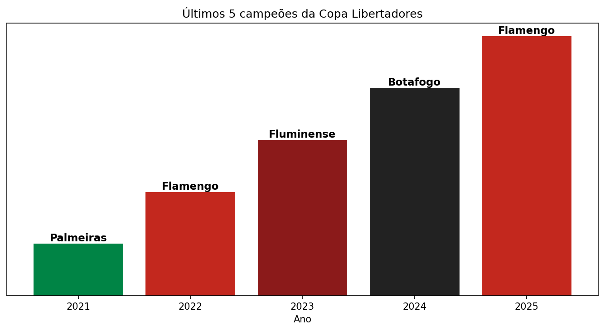

# Campeões da Libertadores

Projeto de estudo em Python que cria um gráfico de barras com os campeões da
Copa Libertadores entre 2021 e 2025.

## Sobre o projeto



## Dados exibidos

| Ano | Campeão |
| --- | --- |
| 2021 | Palmeiras |
| 2022 | Flamengo |
| 2023 | Fluminense |
| 2024 | Botafogo |
| 2025 | Flamengo |

## Pré-requisitos

Para executar o projeto, você precisa ter instalado:

- [Python 3](https://www.python.org/downloads/)
- [Git](https://git-scm.com/downloads/)
- [Matplotlib](https://matplotlib.org/)

Você pode verificar as instalações no terminal:

```bash
python --version
git --version
python -m pip --version
```

## Como executar

1. Clone o repositório:

```bash
git clone https://github.com/luanbalboa10/tutorial2.git
cd tutorial2
```

2. Crie um ambiente virtual e instale as dependências:

```bash
python -m venv .venv
.venv\Scripts\activate
python -m pip install -r requirements.txt
```

3. Execute o programa:

```bash
python tutorial.py
```

O programa abre o gráfico em uma janela e cria a imagem em
`assets/campeoes-libertadores.png`.

## Estrutura do projeto

```text
campeoes-libertadores/
├── .gitignore
├── assets/
│   └── campeoes-libertadores.png
├── README.md
├── requirements.txt
└── tutorial.py
```

## Como contribuir

1. Crie uma branch para sua alteração:

```bash
git switch -c minha-mudanca
```

2. Faça a alteração e revise os arquivos modificados:

```bash
git status
git diff
```

3. Adicione e confirme a alteração:

```bash
git add README.md tutorial.py
git diff --cached
git commit -m "docs: melhora o README do projeto"
```

4. Envie a branch para o GitHub:

```bash
git push -u origin minha-mudanca
```

5. No GitHub, abra um Pull Request para enviar a alteração à branch principal.

## Licença

Adicione aqui a licença escolhida para o projeto. Enquanto não houver uma
licença, considere o código disponível apenas para estudo neste repositório.

## Autor

- [luanbalboa10](https://github.com/luanbalboa10)